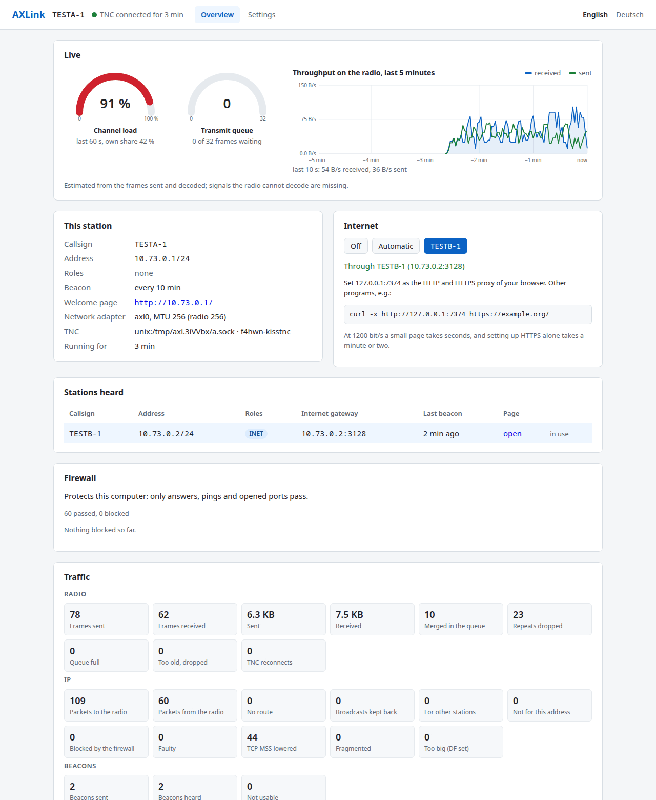
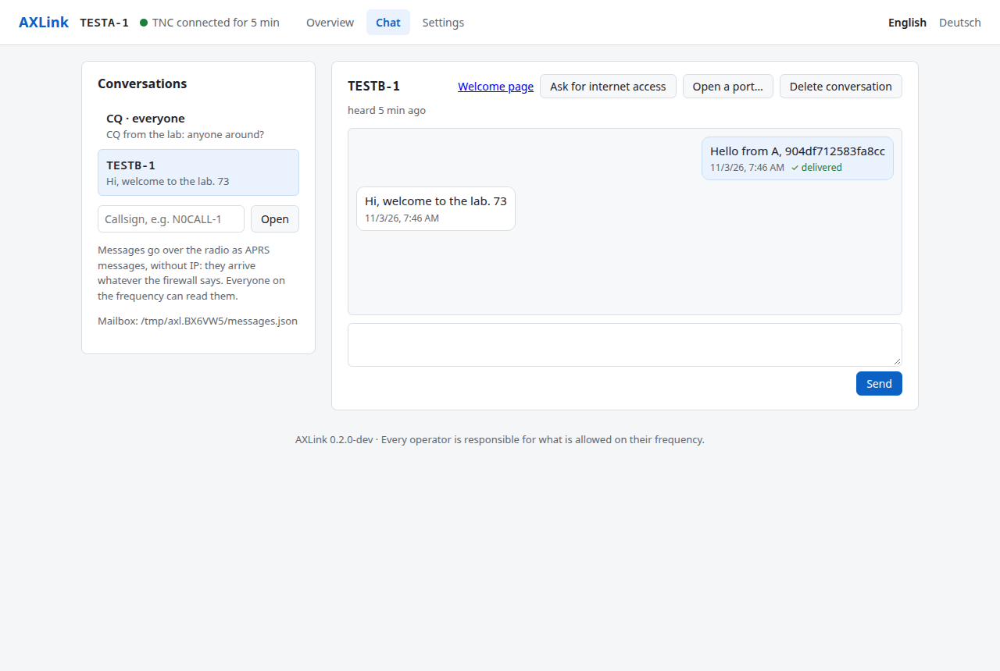
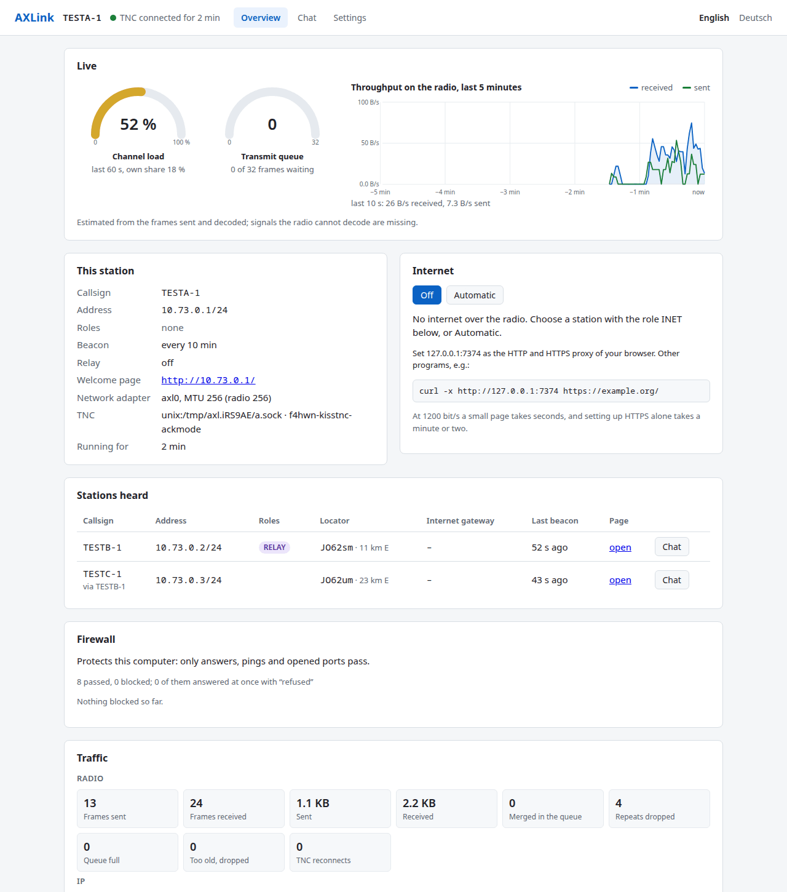
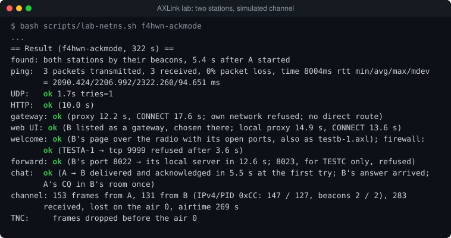

# AXLink — IP over amateur packet radio

<p>
  
  <a href="https://github.com/TechnikWeber/AXLink/releases/latest"></a>
  <a href="https://github.com/TechnikWeber/AXLink/releases"></a>
  <a href="https://github.com/TechnikWeber/AXLink/stargazers"></a>
  <a href="https://github.com/TechnikWeber/AXLink/actions/workflows/ci.yml"></a>
  
  
  
  <a href="LICENSE"></a>
</p>

<p>
  <a href="https://github.com/TechnikWeber/AXLink/releases/latest"><b>Download</b></a> &nbsp;·&nbsp;
  <a href="docs/QUICKSTART.md"><b>Quick start</b></a> &nbsp;·&nbsp;
  <a href="https://technikweber.github.io/2026/vom-handfunkgeraet-ins-netz/"><b>Blog post (German)</b></a> &nbsp;·&nbsp;
  <a href="https://github.com/TechnikWeber/AXLink-TNC"><b>AXLink TNC</b></a> &nbsp;·&nbsp;
  <a href="https://github.com/TechnikWeber/AXLink/releases"><b>Releases</b></a>
</p>

**Ordinary network programs over a handheld radio: ping, browsers, SSH, small web servers and a
chat at 1200 baud.**

AXLink connects a KISS radio or TNC, opens a virtual network adapter and sends IP packets as
AX.25 UI frames (PID `0xCC`), the framing that Linux, JNOS, BPQ and Packet.NET use. Programs work
unchanged, only slowly. Next to that it carries a chat as APRS messages, relays for stations out
of range, and an internet gateway for stations without internet.

It is tuned first to the Quansheng UV-K1 / UV-K5 V3 with the F4HWN firmware and its KISS TNC
app, and works with any KISS TNC (Dire Wolf, hardware TNCs, KISS over TCP).

> **Status: alpha, prerelease 0.2.0-alpha.1.** Works in the lab: stations in their own network
> namespaces with real kernel IP stacks, a simulated channel with a model of the F4HWN KISS app,
> two stations or three with a relay. The network adapter passes its test in CI on Linux,
> Windows and macOS. **Nothing has been on the air with a real radio yet.**
> Start: [QUICKSTART.md](docs/QUICKSTART.md).



*The web interface (`http://127.0.0.1:7373`) of station A in the lab: the live monitor, B found by
its beacon and used as the internet gateway, the firewall and the counters. Taken with headless
Chrome during a lab run on 2026-11-03; the numbers come from the simulated channel, not from a
radio. More: [German](docs/images/client-overview-de.png) ·
settings ([English](docs/images/client-settings-en.png), [German](docs/images/client-settings-de.png)) ·
a gateway ([overview](docs/images/gateway-overview-en.png), [settings](docs/images/gateway-settings-en.png)) ·
a welcome page over the radio ([English](docs/images/welcome-en.png), [German](docs/images/welcome-de.png)).*

## What works

- **A network adapter** on Linux (TUN), Windows (Wintun) and macOS (utun) and IPv4 over AX.25
  UI/PID `0xCC`, with a destination filter, checksum checks, routes and a broadcast filter.
  Radio packets stay at 256 bytes; where the adapter MTU must be larger (Windows: 576), AXLink
  lowers the TCP MSS and fragments.
- **`axlinkd run`:** a radio over USB (F4HWN radios are found by their USB ID `36B7:FFFF`), KISS
  over TCP or a Unix socket. It reconnects after USB resets, paces frames per TNC profile and
  supports ACKMODE ([AXLink TNC](https://github.com/TechnikWeber/AXLink-TNC)).
- **Stations find each other:** each station announces its address, roles (`INET`, `RELAY`, …)
  and, if its operator wants, its locator in a short beacon. No routes to configure; the station
  list shows distance and direction.
- **Chat** as APRS messages straight over the radio, no IP: to a station (acknowledged, repeated,
  kept in a mailbox until the station is heard again, for up to a week) or to everyone in the CQ
  room. Neither the firewall nor the internet sharing stands in the way. Radios with the
  [APRS messenger firmware](https://github.com/TechnikWeber/uv-k1-k5v3-aprs-firmware) speak the
  same format.
- **Mesh:** every station repeats frames for others as a digipeater (on by default,
  switchable), beacons and CQ only where a neighbour may not have them yet; they travel over up
  to two relays, and stations learn over which relays the others are reached
  ([protocol](docs/protocol/mesh.md)).
- **Monitor:** every frame on the channel in the web interface, those for other stations too,
  as with an open squelch ([picture](docs/images/mesh-frames-en.png)); `-pcap` writes them for
  Wireshark.
- **Internet gateway:** a station with internet access shares it as an HTTP proxy (HTTPS through
  CONNECT, names resolved on the gateway), open to everyone or to listed callsigns. A client
  chooses the gateway in its web interface or asks for access in the chat; browser and programs
  use the local proxy `127.0.0.1:7374`.
- **A firewall,** on by default: radio stations reach only answers to own connections, ping and
  the ports you open, optionally per callsign; a refused station learns it at once instead of
  waiting. **Port forwarding** publishes one service of your network (SSH, a web server) on the
  radio address; the rest of your network stays unreachable.
- **A welcome page** per station on its radio address: who runs it, where, with what, which
  ports are open.
- **A web interface** in English and German: a live monitor (channel load, transmit queue,
  throughput as in a task manager), the stations heard, the chat, the gateway and settings that
  survive a restart. It runs on the own computer and needs no internet.
- **A lab without radios:** `scripts/lab-netns.sh` (two stations) and `scripts/lab-mesh.sh`
  (three in a line, the middle one relays) run stations in their own network namespaces (no
  root, no Docker) through a simulated channel with a model of the F4HWN KISS app. The
  two-station lab also runs in CI.



*The chat of station A in the lab: a message to B, delivered and acknowledged at the first try,
and B's answer. APRS messages over the simulated channel, no IP. [German](docs/images/client-chat-de.png).*



*The mesh lab: A hears only B; C, out of A's range, is listed "via TESTB-1" with its locator and
distance, and reached over B. [German](docs/images/mesh-overview-de.png) ·
[a chat with C over B](docs/images/mesh-chat-en.png) · [the lab's result](docs/images/lab-mesh.svg).*



*A lab run (`bash scripts/lab-netns.sh`; picture from its output with `scripts/lab-svg.py`). A
model, not a radio.*

## Quick start

Download the package for Linux, Windows or macOS from the
[releases](https://github.com/TechnikWeber/AXLink/releases), unpack it and start, with your own
callsign and an address agreed with the other stations:

```sh
sudo ./axlinkd run -call <CALL>-1 -port auto -ip 10.73.0.1/24      # Windows: as administrator, axlinkd.exe
# then open http://127.0.0.1:7373 in the browser
```

Step by step for each system, the radio included: [QUICKSTART.md](docs/QUICKSTART.md). From the
source code: `bash scripts/setup-go.sh`, then `go build ./cmd/axlinkd`
([DEVELOPMENT.md](docs/DEVELOPMENT.md)).

Transmitting needs an **amateur radio licence**. Use your own callsign; placeholders such
as `N0CALL` are refused. Every operator is responsible for what is allowed on their
frequency; AXLink does not restrict traffic. AXLink is alpha and comes **"as is", without
any warranty**; the author accepts **no liability** (see [LICENSE](LICENSE)).

## Radio firmware

- F4HWN Labs v6.3.0 with its KISS TNC app (profile `f4hwn-kisstnc`, the default).
- [AXLink TNC](https://github.com/TechnikWeber/AXLink-TNC): our variant of the KISS app with
  ACKMODE, a counter for lost frames and a fix for frames cut by a USB reset (prerelease
  v0.2.0-alpha.1, host-tested, not yet on a radio; profile `f4hwn-kisstnc-ackmode`). Runs on the
  original Labs v6.3.0.
- Messenger and KISS TNC on one radio until F4HWN v7: [MULTIBOOT_V6.md](docs/MULTIBOOT_V6.md).

## Documents

| Document | Content |
|---|---|
| [QUICKSTART.md](docs/QUICKSTART.md) | install and start on Linux, Windows, macOS |
| [BENCH.md](docs/BENCH.md) | the test plan for the first two radios |
| [ARCHITECTURE.md](docs/ARCHITECTURE.md) | how AXLink is built |
| [protocol/](docs/protocol/) | the beacon and the relays (CC BY 4.0) |
| [DECISIONS.md](docs/DECISIONS.md) | the decisions; they take precedence |
| [DEVELOPMENT.md](docs/DEVELOPMENT.md) | build, test, run, lab |
| [TODO.md](docs/TODO.md) | open points |
| [MULTIBOOT_V6.md](docs/MULTIBOOT_V6.md) | messenger and KISS TNC via Multiboot (until v7) |
| [REVIEW_2026-11-02.md](docs/REVIEW_2026-11-02.md) | the review that led to the Go rewrite |
| [HISTORY.md](docs/HISTORY.md) | the v0.1 prototype (pdn/pdn-net) and its findings |
| [CHANGELOG.md](CHANGELOG.md) · [LICENSING.md](LICENSING.md) | changes · licences |

## Licence

GPL-3.0-or-later ([LICENSE](LICENSE)) with an additional permission for Wintun on Windows;
protocol specifications CC BY 4.0. Details and third-party licences: [LICENSING.md](LICENSING.md).
